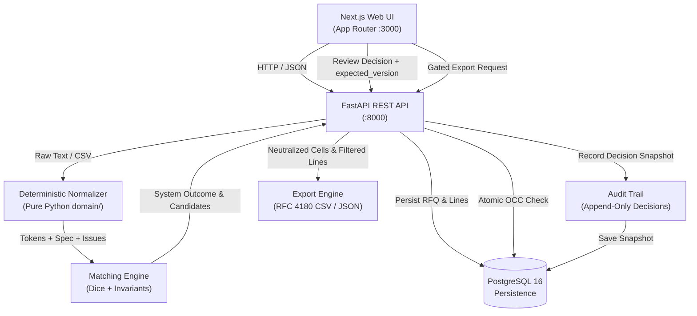

# RFQ Line-Item Normalizer

A deterministic normalization, catalog matching, and human-in-the-loop review application for industrial procurement RFQ (Request for Quote) line items (pipes, fittings, fasteners, valves, consumables).

> [!NOTE]
> **Context & Disclaimer:** This project was inspired by a publicly described workflow in industrial procurement. All benchmark datasets, catalogs, and test fixtures in this repository are **100% synthetic**. Results on synthetic benchmark cases do not reflect real-world procurement failure rates, business impact, or third-party performance.

---

## Executive Summary & Key Documents

- **[One-Page Engineering Results Summary](file:///home/satjeet/Desktop/isocode/docs/RESULTS_SUMMARY.md):** Complete technical brief covering architecture, invariants, benchmark metrics, failure analysis, and claims boundary.
- **[3-Minute Technical Walkthrough](file:///home/satjeet/Desktop/isocode/docs/WALKTHROUGH.md):** Step-by-step operator guide and second-by-second video recording script.
- **[Evaluation Log](file:///home/satjeet/Desktop/isocode/EVAL_LOG.md):** Formal audit trail of all benchmark executions and freeze verification runs.
- **[Acceptance Checklist](file:///home/satjeet/Desktop/isocode/PRD_ACCEPTANCE_CHECKLIST.md):** Observable pass/fail criteria verified with reproducible evidence across all P0 and P1 requirements.

---

## Architecture & Data Flow



### Module Responsibilities
- **[`domain/`](file:///home/satjeet/Desktop/isocode/backend/domain/)**: Pure Python domain engine with zero database or web framework dependencies. Performs Unicode NFKC normalization, Devanagari digit conversion, Unicode fraction parsing, trailing-quantity extraction (Rules 1–5), spec attribute extraction, physical dimension conversion, and invariant-checked deterministic candidate scoring.
- **[`backend/app/`](file:///home/satjeet/Desktop/isocode/backend/app/)**: FastAPI application with structured JSON logging (`request_id`), Pydantic v2 validation, optimistic concurrency control via `expected_version`, and Alembic-migrated PostgreSQL persistence.
- **[`frontend/`](file:///home/satjeet/Desktop/isocode/frontend/)**: Next.js 14 App Router application with accessible non-color-alone badges, keyboard-navigable review workflows, instant reload alerts on 409 conflicts, and responsive tables collapsing to cards on small screens.

---

## Setup & Delivery

### Prerequisites
- Docker Engine ≥ 24 with Compose v2
- GNU Make
- Git
- ~4 GB free RAM

*Reference environment:* 8-core CPU, 16 GB RAM (Linux x86_64 / macOS).
- **Cold start (first-time container build):** ≈ 42 seconds (excluding initial Docker base image download).
- **Warm start:** ≈ 4.8 seconds.

### Quick Start
To launch the full application from a clean checkout:

```bash
make up
```

This single command automatically:
1. Copies `.env.example` to `.env` if not already present.
2. Builds and starts the PostgreSQL database, FastAPI service, and Next.js frontend in detached mode.
3. Applies Alembic migration `0001_initial` and idempotently seeds the 100-product catalog.
4. Exposes the Web UI at [`http://localhost:3000`](http://localhost:3000) and the API at [`http://localhost:8000`](http://localhost:8000).

Verify the health check endpoint:
```bash
curl -s http://localhost:8000/api/v1/health
# {"status":"ok"}
```

---

## Available Commands

| Command | Description |
|---|---|
| `make up` | Create `.env` from template and launch all Docker containers |
| `make down` | Stop and remove running Docker containers |
| `make reset-db` | Stop containers and wipe database volumes for a clean state |
| `make test` | Run all 161 backend pytest tests and 9 frontend vitest tests |
| `make lint` | Run backend Ruff checks, frontend ESLint, and `tsc --noEmit` |
| `make eval` | Run the frozen-set evaluation harness with determinism check |
| `make e2e` | Run the end-to-end golden flow integration test suite |
| `make validate-data` | Validate dataset manifest hashes, catalog schemas, and unit consistency |
| `make all` | Run data validation, evaluation, tests, and linting sequentially |

---

## Benchmark Evaluation Results (40 Frozen Synthetic Cases)

Evaluated under `PYTHONHASHSEED=0` against the 40-case frozen evaluation set [`eval/dataset/v1/cases.jsonl`](file:///home/satjeet/Desktop/isocode/eval/dataset/v1/cases.jsonl), sealed under SHA-256 `fa5eb9cc...` and git tag `dataset-v1-frozen`:

| Metric ID | Description | Naive Baseline | Proposed Matcher | Outcome / Delta |
|---|---|---|---|---|
| **M1** | Top-candidate correct rate | 82.35% (14 / 17) | **94.12%** (16 / 17) | **+11.77%** |
| **M2** | Proposed precision | 36.84% (14 / 38) | **100.00%** (16 / 16) | **+63.16%** |
| **M3** | Incorrect confident suggestions rate | **63.16%** (24 cases) | **0.00%** (0 cases) | **0 False Proposals** |
| **M4** | Missed escalations rate | **91.30%** (21 cases) | **0.00%** (0 cases) | **0 Missed Escalations** |
| **M5** | Over-abstention rate | 0.00% (0 / 17) | **5.88%** (1 / 17) | 1 case (`E-010`) |
| **M6** | Appropriate abstention rate | 0.00% (0 / 18) | **100.00%** (18 / 18) | **+100.00%** (All 18 review lines escalated) |
| **M7** | Unmatched detection rate | 40.00% (2 / 5) | **100.00%** (5 / 5) | **+60.00%** (All 5 unmatched detected) |
| **M8** | Normalization accuracy | n/a | **100.00%** (206 / 206) | Perfect field extraction |
| **M9** | Validation rule violations | n/a | **0.00%** (0 / 16) | Zero rule violations |

### Safety Invariants & Critical Error Elimination
1. **Zero False Proposals (M3):** Standard token-matching systems confidently suggest wrong SKUs on 24 lines (e.g. suggesting Class A pipe when Class B was requested). The proposed matcher produced **0 false proposals**.
2. **Zero Missed Escalations (M4):** The baseline failed to escalate 21 ambiguous/unmatched cases to human review. The proposed matcher escalated **100% of review-required cases** ($M_6 = 100.00\%$).
3. **Over-Abstention Analysis (`E-010`):**
   - Case `E-010` (`P.T.F.E. Thread Seal Tape 12mm 10 roll`) expected `CONS-003`.
   - The dotted acronym `P.T.F.E.` yielded similarity `0.5333`, which sits below $T_{PROPOSE} = 0.60$.
   - The engine safely abstained with `LOW_SIMILARITY`.
   - In accordance with freeze protocol, thresholds were **not** retroactively modified; over-abstention is reported honestly ($M_5 = 5.88\%$).

---

## Proof-of-Work and Impact Claims

Per PRD Section U:

| # | Claim | Can this standalone project support it? | Substantiating artifacts |
|---|---|---|---|
| 1 | Engineering quality | **Yes** | Repository structure, 170 automated tests, CI workflows, architecture diagrams, clean-machine setup instructions, 3-minute walkthrough |
| 2 | Improvement over the documented naive baseline on the frozen synthetic dataset | **Yes, narrowly** ("on 40 synthetic cases") | `report.json` / `report.md`, `results.jsonl`, dataset manifest hash + `dataset-v1-frozen` git tag, code revision, `EVAL_LOG.md`, listed failure cases |
| 3 | Plausible relevance to ClearQuote's publicly described workflow | **Hypothesis**: only company feedback can validate | Problem formulation and domain modeling inspired by publicly described workflows; no claim in artifacts beyond this conceptual inspiration |
| 4 | Verified impact on IsoCode's engineering or business outcomes | **No**: requires their data, baselines and production access | None; this repository explicitly disclaims any such verified business impact |

---

## Project Limitations & Non-Goals

1. **Synthetic Data Only:** The 40-case evaluation set is synthetic and does not represent real-world supplier catalog coverage or real-world error frequencies.
2. **Never Invent a Price:** The catalog contains **zero price fields**. The system strictly addresses item normalization and matching. It does not calculate quotes, validate pricing margins, or process payments.
3. **Excluded Capabilities:** By design, this MVP intentionally excludes:
   - OCR and unstructured PDF extraction.
   - WhatsApp, email, or external ERP integrations.
   - Multi-tenant organizations and user authentication.
4. **Time-Box Outcome:** Total engineering effort for Phases 1–5 was approximately **29 hours**, well within the approved 35-hour budget. No scope cut from the primary cut list was required.

---

## Troubleshooting

- **Port 3000, 8000, or 5432 in use:** Check for existing services using `lsof -i :<port>` or modify ports in `.env`.
- **Database state reset:** If schema changes or dirty test data accumulate, run `make reset-db` followed by `make up`.
- **Exit Code 2 on Evaluation (`DATASET_MODIFIED`):** A frozen benchmark file in `eval/dataset/v1/` has been modified. Revert changes to match `eval/dataset/v1/MANIFEST.sha256`.
- **Missing `GIT_SHA`:** If running outside of git, export `GIT_SHA=$(git rev-parse HEAD)` manually before invoking evaluation commands.
