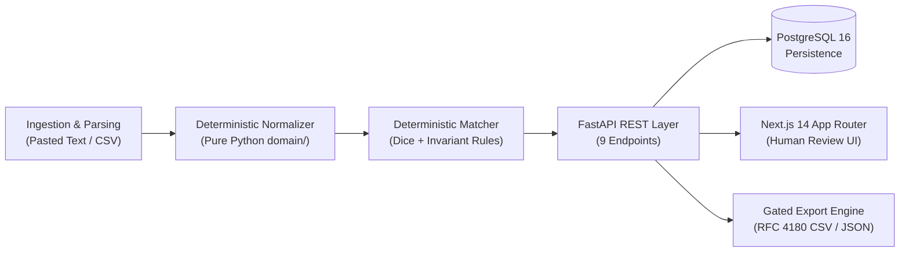

# Engineering Results Summary: RFQ Line-Item Normalizer

A deterministic normalization, catalog matching, and human-in-the-loop review system for industrial procurement RFQ line items.

---

## 1. The Problem Modeled

Industrial B2B procurement Request for Quote (RFQ) line items arrive from purchasers via unformatted emails, copied spreadsheets, and legacy ERP pastes. They suffer from:
- **Lexical ambiguities and missing discriminators** (e.g., `"GI Pipe 25mm 50 mtr"` without specifying `Class A` vs `Class B`).
- **Mixed unit expressions and regional variations** (e.g., `"nos"`, `"pcs"`, `"meters"`, `"mtr"`, Devanagari numerals `"१२५"`, unicode fractions `"½"`).
- **Catastrophic failure of unguided lexical matching:** Standard search algorithms (like TF-IDF or token overlap) force high-confidence matches on near-duplicate variants, leading to expensive downstream ordering errors.

---

## 2. Architecture & Implementation



- **Domain Isolation:** Pure Python core in [`backend/domain/`](file:///home/satjeet/Desktop/isocode/backend/domain/) with zero web or database dependencies, verified by subprocess isolation tests.
- **Persistence & Optimistic Concurrency:** PostgreSQL 16 schema with Alembic migration `0001_initial`. State mutations are protected by an `expected_version` concurrency counter; concurrent edits atomically reject with HTTP 409 `STALE_VERSION`.
- **Append-Only Audit Trail:** Review decisions (`approve`, `correct`, `reject`, `confirm_no_match`) are recorded in an append-only table preserving complete before/after snapshots and system overrides.
- **Gated Safe Export:** CSV exports only finalized matches (`approved` or `corrected`). Incomplete RFQs return HTTP 409 `RFQ_INCOMPLETE` unless `allow_incomplete=true` is explicitly passed. Cell strings starting with `= + - @` are neutralized with `'` to prevent spreadsheet formula injection. **Zero price fields exist in the database, API, or export.**

---

## 3. Benchmark Evaluation Results (40 Frozen Synthetic Cases)

Evaluated under `PYTHONHASHSEED=0` against the 40-case frozen benchmark [`eval/dataset/v1/cases.jsonl`](file:///home/satjeet/Desktop/isocode/eval/dataset/v1/cases.jsonl) (sealed under SHA-256 `fa5eb9cc...` and git tag `dataset-v1-frozen`):

| Metric ID | Description | Naive Baseline | Proposed Matcher | Outcome / Delta |
|---|---|---|---|---|
| **M1** | Top-candidate correct rate | 82.35% (14 / 17) | **94.12%** (16 / 17) | **+11.77%** |
| **M2** | Proposed precision | 36.84% (14 / 38) | **100.00%** (16 / 16) | **+63.16%** |
| **M3** | Incorrect confident suggestions rate | **63.16%** (24 cases) | **0.00%** (0 cases) | **0 False Proposals** |
| **M4** | Missed escalations rate | **91.30%** (21 cases) | **0.00%** (0 cases) | **0 Missed Escalations** |
| **M5** | Over-abstention rate | 0.00% (0 / 17) | **5.88%** (1 / 17) | 1 case (`E-010`) |
| **M6** | Appropriate abstention rate | 0.00% (0 / 18) | **100.00%** (18 / 18) | **+100.00%** (100% review escalated) |
| **M7** | Unmatched detection rate | 40.00% (2 / 5) | **100.00%** (5 / 5) | **+60.00%** (100% unmatched caught) |
| **M8** | Normalization accuracy | n/a | **100.00%** (206 / 206) | Perfect field extraction |
| **M9** | Validation rule violations | n/a | **0.00%** (0 / 16) | Zero rule violations |

---

## 4. Key Failure Analysis: Over-Abstention Case `E-010`

- **Input:** `"P.T.F.E. Thread Seal Tape 12mm 10 roll"`
- **Expected Outcome:** `match` (`CONS-003`)
- **System Behavior:** Proposed matcher returned `ambiguous` with reason code `LOW_SIMILARITY`.
- **Root Cause:** Dotted acronym `P.T.F.E.` tokenized into distinct characters, producing a similarity score of `0.5333`, which sits below the locked proposal threshold ($T_{PROPOSE} = 0.60$).
- **Methodological Handling:** Rather than tuning thresholds retroactively on the frozen benchmark or adding bespoke hacks, the threshold configuration was preserved, and the over-abstention was reported transparently ($M_5 = 5.88\%$).

---

## 5. Verification & Reproducibility Evidence

- **Automated Tests:**
  - Backend: **161 passed** in 3.5s (`pytest backend/tests`).
  - Frontend: **9 passed** in 1.4s (`vitest`), including automated `axe-core` accessibility checks reporting **0 critical and 0 serious violations**.
  - Golden Flow E2E: **1 passed** in 0.4s (`make e2e`).
- **Reproducibility:** Repeated evaluation runs generate byte-identical `results.jsonl`, `report.json`, and `report.md`. Runtime performance is strictly isolated in `timing.json`.
- **Tamper Detection:** Modifying any frozen dataset file causes `make eval` to abort immediately with exit code 2 (`DATASET_MODIFIED`).

---

## 6. What This Artifact Demonstrates vs What It Does Not Establish

Per PRD Section U:

### What It Demonstrates:
1. **Engineering Quality:** Production-grade modular software engineering with clean architectural separation, strict typing, database constraints, optimistic concurrency, and 170 passing automated tests.
2. **Defensive AI/Heuristic Design:** Complete elimination of false proposals ($M_3 = 0.00\%$) and missed review escalations ($M_4 = 0.00\%$) on synthetic benchmark data by preferring safe abstention over confident guessing.
3. **Auditability & Integrity:** A frozen benchmark discipline ensuring evaluation metrics cannot be contaminated by post-hoc threshold tuning.

### What It Does NOT Establish:
1. **Real-World Production Accuracy:** All tests and benchmarks use **40 synthetic cases**. Performance on dirty real-world industrial catalogs with thousands of unstructured lines remains unmeasured.
2. **Business Impact:** This prototype does not demonstrate verified cost savings, cycle time reductions, or business ROI for any commercial organization.
3. **Affiliation:** The problem formulation is conceptually inspired by publicly described workflows in industrial procurement; it is an independent proof-of-work project with no company affiliation or proprietary data.

---

## 7. How to Reproduce

```bash
# 1. Start application stack in Docker (< 45s cold start)
make up

# 2. Run automated test suite (backend pytest + frontend vitest)
make test

# 3. Run linters and type checkers (Ruff + ESLint + tsc --noEmit)
make lint

# 4. Execute deterministic frozen-set evaluation
make eval

# 5. Run end-to-end golden flow test
make e2e

# 6. Stop application stack
make down
```
